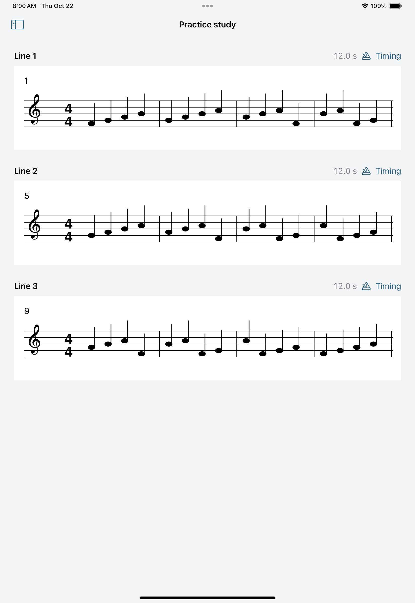

# Native build evidence

The v0.1 tempo-guided practice preview passed its integrated native gate at
a60b347c834572c2d82ea34a91630517509b9f7d: 35 Core, 13 native and all 13 UI
tests passed, including live mixer capture, automatic line changes, the 200%
repeat and complete preparation/save/cancel. Accepted captures, receipts and
device boundaries are in [PRACTICE_VERIFICATION.md](PRACTICE_VERIFICATION.md).

The earlier V1 recognition/rendering gate is recorded in
[V1_NATIVE_VERIFICATION.md](V1_NATIVE_VERIFICATION.md).

## First foundation checkpoint

The evidence below records the original foundation build.

Verified on 22 October 2026 at commit
792a59e5e90a1a26805a8d484401c85cf1f15a42.

[Successful macOS workflow](https://github.com/wenshanvincent-creator/scoreprep-ipad/actions/runs/39743968563)

- Xcode 16.4, build 16F6.
- iOS 18.5 simulator, iPad Pro 11-inch (M4).
- Ten ScoreCore tests passed with zero failures.
- The native app compiled and one UI smoke test passed with zero failures.
- The smoke test opened the generated sample score and its timing editor.
- A simulator screenshot was retrieved and visually inspected.

The screenshot shows original source notation in three reading areas with
their calculated 12-second durations. It is a simulator capture, not a
design mockup.

That foundation run did not validate continuous practice audio or line
advancement; those checks belong to the v0.1 evidence above. Physical output,
broader score variety, Pencil, pedals and TestFlight installation require
their own later validation.
