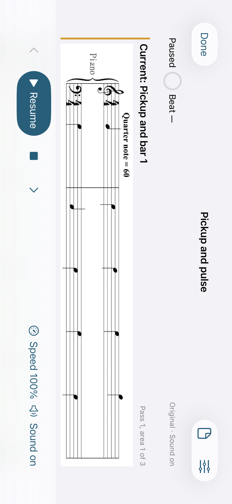

# iPhone beta preparation evidence

Native iPhone and unsigned archive checks passed for source
`96d13d11a4a20503558b70e6161d66c4bab818e7`.

## Changes being checked

- The application supports iPhone and iPad, with minimum OS 18.
- A fresh compact-screen launch opens the library; selecting or importing a
  score opens its reader using native collapsed split-view navigation.
- Practice headings and transport adapt to narrow widths. Landscape status
  uses one row so the complete current exercise system fits above the transport.
- Accessibility text keeps touch transport controls reachable and moves speed
  and sound settings into Practice options when necessary.
- The release archive includes an original opaque icon and required-reason
  declarations for app-local file metadata, preferences and elapsed timing.

## Final gates

| Gate | Run | Result |
| --- | --- | --- |
| iPhone 13, iOS 26 native UI | [39883491212](https://github.com/wenshanvincent-creator/scoreprep-ipad/actions/runs/39883491212) | 2 passed, no failures |
| Universal release archive, Xcode 26.0.1 | [39883490882](https://github.com/wenshanvincent-creator/scoreprep-ipad/actions/runs/39883490882) | Passed; signing/upload skipped |
| Existing iPad regression, Xcode 16.4 | [39883490962](https://github.com/wenshanvincent-creator/scoreprep-ipad/actions/runs/39883490962) | Pending |
| Remote OMR and native notation | [39883490983](https://github.com/wenshanvincent-creator/scoreprep-ipad/actions/runs/39883490983) | Passed |

The focused phone tests cover fresh library entry, preparation presentation,
portrait practice, play/pause, landscape, next-area navigation, options, return
to the reader and accessibility controls. The landscape check asserts that the
entire current notation frame lies inside the scroll viewport, catching staff
clipping that a reachable-button test would miss. Screenshots must also be
inspected before marking this gate accepted. The final portrait, landscape and
accessibility captures were inspected; the landscape current staff is fully
visible above the transport.

Other native captures: [portrait practice](assets/iphone-practice-portrait.png),
[large-text practice](assets/iphone-practice-large-text.png),
[reader](assets/iphone-reader-portrait.png),
[preparation](assets/iphone-preparation-portrait.png), and
[large-text options](assets/iphone-options-large-text.png).

The phone artifact is `12472237147`; the archive artifact is `12472325899`.
The archive checker inspected the real application bundle for device families
1 and 2, minimum OS 18.0, SDK iphoneos26.0, the compiled app icon and all three
required-reason declarations. Its original
[receipt](assets/iphone-beta-archive-receipt.json) identifies version 0.1.0,
build 3, and explicitly records unsigned/unuploaded status. Artifacts expire
after seven days; these selected captures and metadata are retained here.

## Distribution boundary

An unsigned archive is build evidence, not an installable beta. The manual
signed-upload lane is prepared but has not been exercised with real credentials.
Account-holder enrollment, signing assets, App Store Connect processing,
invitation and physical iPhone/iPad testing remain pending. Enrollment and
signing setup require action by the eligible account holder.

See [TestFlight setup](TESTFLIGHT_SETUP.md) and [draft beta notes](BETA_TEST_NOTES.md).
The previous iPad practice and audio evidence remains in
[PRACTICE_VERIFICATION.md](PRACTICE_VERIFICATION.md).

## iPad observation investigation

The first attempt of the iPad run passed 35 Core and 13 native tests, including
live mixer output, and 12 of the 13 existing iPad UI tests. Two phone-only cases
were skipped on iPad as intended. The repeated 200% loop case timed out while
polling for its short middle area. The following-area and wrap assertions still
completed while Playing. The exported recording independently shows that middle
area on screen: [frame at 47 seconds](assets/ipad-repeat-observation-frame.png),
from attachment `C993DF09-A742-44EE-A110-A2930B683A4B.mp4` in first-attempt
artifact `12473105806`. This frame is diagnostic visual evidence, not a
sample-accurate timing measurement or a passing test result.

The failed iPad job was rerun once at the same source and repeated the failure.
The logs identify the race as the redundant starting-area observation after
waiting for Playing: at 200%, the initial area lasts 2.5 seconds and can already
have advanced when that observation starts. The starting area is already
asserted before Resume. The test now proceeds directly from Playing to the
next area, keeping all B/C/wrap, speed and Playing assertions and their original
deadlines. The application code is unchanged. Validation of this test correction
is pending.
