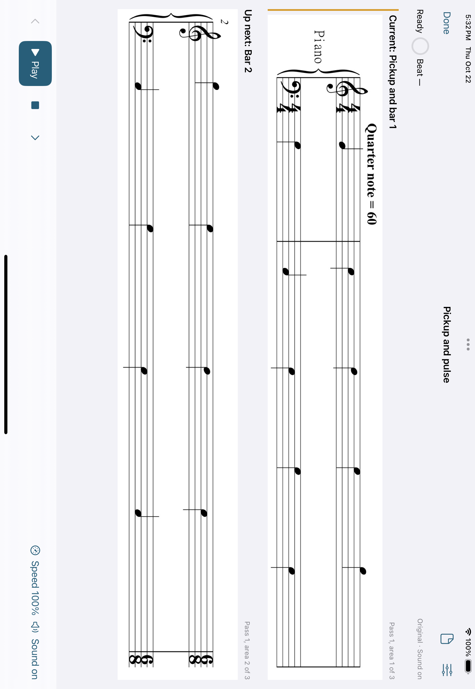
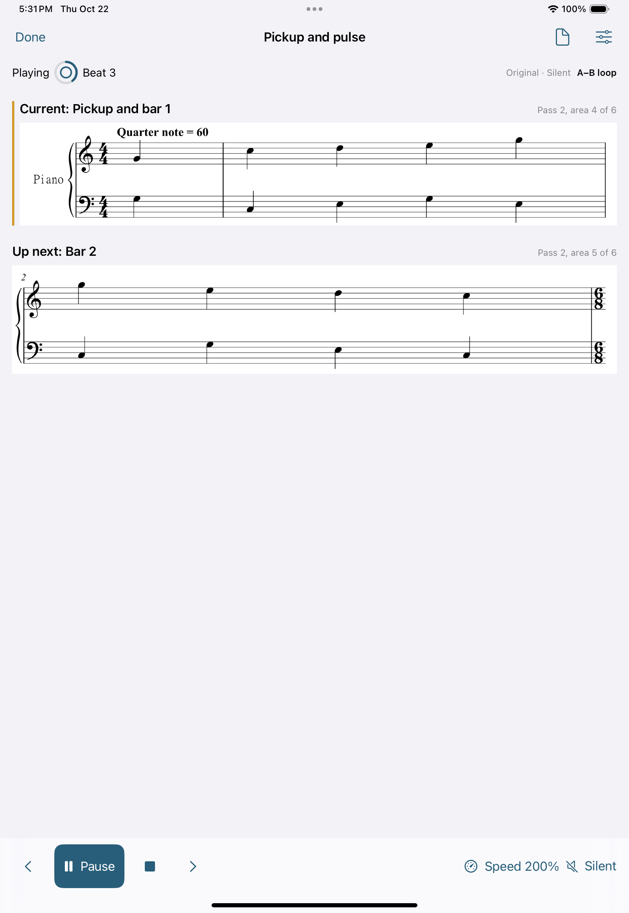

# Native practice verification

The v0.1 practice engineering gate passed on 22 October 2026 at
a60b347c834572c2d82ea34a91630517509b9f7d. The final recognition-harness check
passed at 06cdab18d19802d586ac3141af4d94c2a03ec182; that change only waits
for native layout and its source-page callback before asserting navigation.
The app, Core, audio, rendering and main app tests are unchanged.

## Accepted checks

| Source | Check | Result |
| --- | --- | --- |
| a60b347c834572c2d82ea34a91630517509b9f7d | [Integrated native verification](https://github.com/wenshanvincent-creator/scoreprep-ipad/actions/runs/39820728301) | Passed: 35 Core, 13 native and all 13 UI tests. Includes actual live mixer PCM without a skip, uninterrupted automatic advancement, the 200% repeat and complete preparation/save/cancel. |
| 06cdab18d19802d586ac3141af4d94c2a03ec182 | [Recognition and engraving](https://github.com/wenshanvincent-creator/scoreprep-ipad/actions/runs/39825251593) | Passed: actual cloud homr through the worker API, 5 native contract tests and all 3 rendering UI tests, including the exact source-page callback after layout and navigation. |

Toolchain: Xcode 16.4, build 16F6; iOS 18.5 simulator,
iPad Pro 11-inch (M4). Accepted practice captures and receipts were retrieved
from artifact 12446286838 and inspected. V1's earlier remote recognition,
native rendering and offline review gate is recorded in
[V1_NATIVE_VERIFICATION.md](V1_NATIVE_VERIFICATION.md).

Recognition's final native artifact 12447591675 also supplied the inspected
[source-page callback capture](assets/recognition-source-link.png). After
resizing and portrait reflow, Previous displays source page 3 and reports
Linked source 3, preserving the initial source-8 assertions before navigation.

The delivery adds documentation and captured evidence after these sources.
App/build and main test sources match a60b347; the recognition harness matches
06cdab1. These boundaries were checked before merging.

## v0.1 requirement coverage

| Requirement | Evidence |
| --- | --- |
| PDF/JPEG/PNG import and offline original library | Native import/copy, rename, crop, rotated-page, cold-reopen and confirmed deletion walkthroughs passed. Original source bytes remain intact. |
| Multiple complete-system areas and explicit repeat order | The UI added and named an area, moved it, added a reading pass, saved and cold reopened. Removal was verified before Cancel, then the saved area was restored. Original pages remained reachable after rotation. |
| Complete meter, pulse, BPM and performed-quarter-beat arrays | Core timeline checks and native persistence cover pickups, fractional phases and meter/tempo changes. The actual timing editor saved and cold reopened multiple fractional segments. |
| Current/upcoming music in both orientations | Portrait, landscape and largest-text captures were inspected. Complete grand staffs and the transport fit. The final area has no upcoming system. |
| One clock, audible/silent beat and count-in | Core transport/pulse checks, native controller cancellation and system notifications passed. Actual live mixer PCM was captured without a skip; see the audio boundary below. |
| Automatic line advancement | The uninterrupted silent take visited areas 1/2/3 and Finished in order, using the confirmed 5/9/13-second route. Its exported observation receipt passed the unchanged Play-bracket and polling limits. |
| Speed, A–B loops and immediate manual navigation | The uninterrupted 200% take advanced through Pass 2 areas 4/5/6 and wrapped to area 4 while Playing. Manual next/previous pauses, count-in interruption, resume, end and stop also passed. |
| Design process and repeatable demonstration | UI_SKILLS.md and the UI plans record the applied native design skills. [PRACTICE_DEMO.md](PRACTICE_DEMO.md) supplies the owned exercise, expected timings and an imported-score walkthrough. |

## Captured audio

The [live mixer receipt](assets/practice-live-mixer-receipt.json) and
[mono 48 kHz WAV](assets/practice-live-mixer-with-pause.wav) come from the
accepted native run above. The owned source PNG's exact SHA-256 is recorded.
The take used two-times speed and one count-in bar. Seventeen clicks were
scheduled; one queued future click was canceled on pause. All sixteen remaining
onsets were captured, with none during the paused interval.

The test compares mixer host timestamps with scheduled events using 40 ms
of tolerance. This establishes app-mixer scheduling and cancellation.
Physical speaker latency, Bluetooth output and playing against an instrument
require a real iPad.

A separate [offline rendering receipt](assets/practice-offline-receipt.json)
records clicks at approximately 0 and 0.25 seconds; the queued 0.5-second click
did not render after stop at 0.35 seconds. Offline rendering is a separate check.

## Visible automatic advancement

The [UI timing receipt](assets/practice-automatic-advance-receipt.json) comes
from the accepted uninterrupted take at 100%, silent, without count-in.
No navigation, pause, speed or loop commands intervened.

| Expected boundary | Observation since Play began |
| --- | --- |
| Area 2 at 5 seconds | 5.54 seconds |
| Area 3 at 9 seconds | 10.07 seconds |
| Finished at 13 seconds | 13.47 seconds |

The Play action lasted 0.526 seconds, bracketing the actual start. The unchanged
UI polling allowance is 1.25 seconds after the action returns. The receipt
retains both clocks and the label-query method. These are visible UI
observations, not sample-accurate audio measurements.

The [largest-text capture](assets/practice-large-text.png) retains both complete
systems and reachable primary controls. The
[reading-order capture](assets/practice-reading-order.png) shows two saved
passes. The loop capture below shows the automatic return to Pass 2 area 4,
with area 5 upcoming and 200% speed still Playing.

## Device and distribution follow-ups

Cloud simulator checks do not establish a physical-iPad rehearsal or App Store
installation. Remaining steps are Mac/Xcode access for a signed device build,
Apple signing and distribution setup, and a physical iPad/musician rehearsal.
No account purchase, production recognition endpoint, TestFlight upload or
App Store submission has been performed by this milestone.

Practice follows confirmed timing at the selected speed. Voice and classical
chroma/online-DTW performance following remain subsequent phases.
