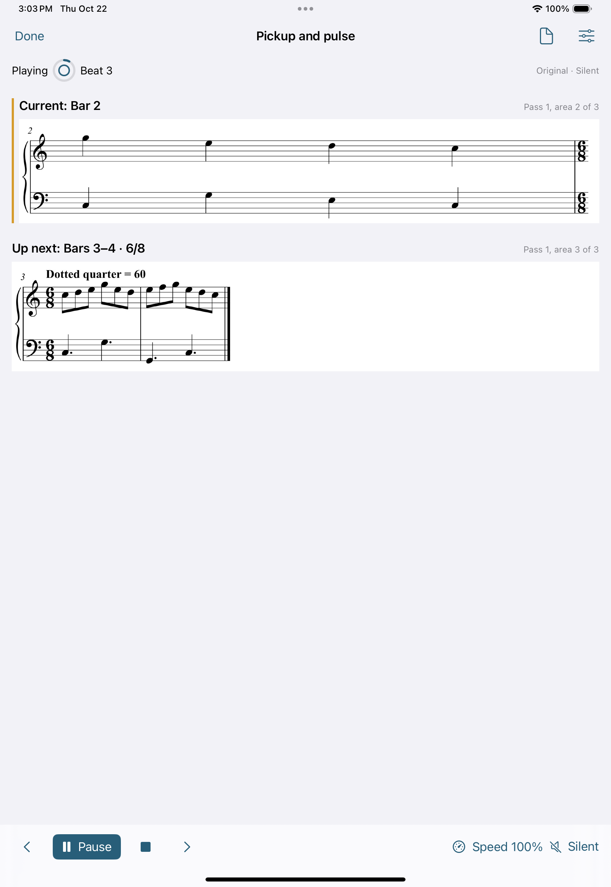
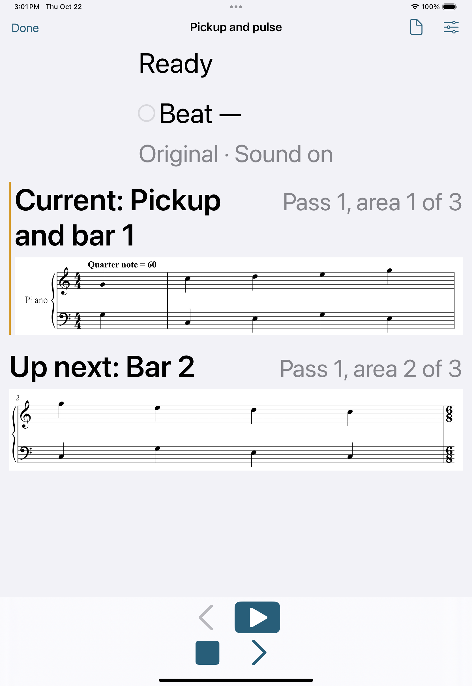

# Native practice verification

Status: integrated practice acceptance is in progress. V1 is already verified
and merged; see [its evidence](V1_NATIVE_VERIFICATION.md).

## Recorded checkpoints

| Source | Check | Result |
| --- | --- | --- |
| 691006355ca1ee11d9b26985fbec0f89c17603c6 | [Native foundation run](https://github.com/wenshanvincent-creator/scoreprep-ipad/actions/runs/39784018833) | Passed: 27 Core, 4 native and 7 UI tests. Includes the owned practice exercise's actual import, source hash, cold reopen and compiled pickup/compound timing. This predates the complete practice UI and audio tests. |
| bc3c8b1b298b2c187d61faca8b7f2af7a4f83d39 | [Recognition and engraving](https://github.com/wenshanvincent-creator/scoreprep-ipad/actions/runs/39788035897) | Passed: real cloud homr trial plus 5 native contract and 3 rendering UI tests. |
| bc3c8b1b298b2c187d61faca8b7f2af7a4f83d39 | [Integrated practice candidate](https://github.com/wenshanvincent-creator/scoreprep-ipad/actions/runs/39788035850) | 34 Core and 13 native tests passed, including live mixer capture. Existing 7 UI checks passed; 6 new practice UI tests failed around sidebar/menu navigation, ambiguous Done buttons and offscreen fields. Full practice acceptance remains open. |
| 4a4a39e4ec2cd50210d7932bc517d8e65d39edcd | [Practice interaction run](https://github.com/wenshanvincent-creator/scoreprep-ipad/actions/runs/39793418248) | 35 Core and 13 native tests passed, including the final-pulse regression and live mixer capture. Nine of thirteen UI tests passed: the existing seven, manual playback/navigation, and fractional multi-segment timing cold reopen. Four tests remain blocked by an undismissed native sidebar popup and overscrolling past Add reading area. |
| 4a4a39e4ec2cd50210d7932bc517d8e65d39edcd | [Recognition and engraving](https://github.com/wenshanvincent-creator/scoreprep-ipad/actions/runs/39793418242) | Passed: real cloud homr trial plus 5 native contract and 3 rendering UI tests. |
| 50991f41002fdd98de7117c7e7543898fef5464d | [Automatic practice run](https://github.com/wenshanvincent-creator/scoreprep-ipad/actions/runs/39799149132) | 35 Core and 13 native tests passed. Ten of thirteen UI tests passed, including automatic 5/9/13-second advancement, largest-text practice controls, manual interruption and timing cold reopen. Two preparation-menu selections and the library deletion/cold-reopen check still fail. |

The integrated checkout also includes 058b7d4's focused final-pulse display
correction. Its targeted regression passed in the 35-test Core run above.
No acceptance claim depends on the existence of tests alone.

## v0.1 requirement coverage

| Requirement | Evidence boundary |
| --- | --- |
| PDF/JPEG/PNG import and offline original library | Existing native import/copy, rename, crop, rotated-page and cold-reopen UI checks passed at the recorded V1 and bc3c8b1 checkpoints. |
| Several complete-system areas, explicit sections/repeat order, original preservation | Core preparation validation and native atomic-store/draft tests passed. The full add/move/remove/save/cancel UI walkthrough still needs its corrected native run. |
| Full meter, pulse, BPM and performed-quarter-beat arrays, including pickups | Core timeline/count-in checks, native fractional/one-based phase round trips and the actual multi-segment timing-editor cold-reopen UI check passed. |
| Current/upcoming music in both orientations | Native portrait and landscape inspected at 4a4a39e. Both complete grand staffs and transport fit. Largest-text control interaction and its capture passed and were inspected at 50991f4. |
| One clock, audible/silent beat, count-in and automatic line focus | Transport/pulse checks, actual native mixer capture and the uninterrupted visible 5/9/13-second advancement take passed. See the captured UI receipt below for its polling boundary. |
| Speed, A–B looping and immediate manual pause/navigation | Pure transport and native controller cancellation checks and actual manual-interruption UI passed. The actual 200% timed loop wrap remains pending behind preparation-menu selection. |
| Native design process and repeatable demonstration | UI_SKILLS.md and the workstream plans record the selected skills and preflight. PRACTICE_DEMO.md supplies the owned exercise and import walkthrough; final inspected captures and native receipts complete acceptance. |

## Captured audio at bc3c8b1

The actual native live-mixer test passed without a skip on the iPad Pro
11-inch (M4), iOS 18.5 simulator under Xcode 16.4. Its exported
[receipt](assets/practice-live-mixer-receipt.json) and
[mono WAV](assets/practice-live-mixer-with-pause.wav) were retrieved from
artifact 12430113624 and inspected. The receipt uses the owned PNG's exact
SHA-256, two-times speed and one count-in bar. Sixteen expected click onsets
were captured; one already queued future click was canceled, with no onset
during the pause. The test compares live mixer host timestamps with scheduled
events using 40 milliseconds of tolerance. This is app-mixer evidence, not
physical speaker latency.

A separate [offline rendering receipt](assets/practice-offline-receipt.json)
records clicks at approximately 0 and 0.25 seconds; the queued 0.5-second click
did not render after stop at 0.35 seconds. It is not a substitute for the live
host-clock capture above.

Native portrait/landscape practice and multi-segment timing/reopened captures
were retrieved from artifact 12433483678 and inspected. Both complete grand
staffs and transport fit. Timing fields, explicit dotted-quarter pulse and
calculated duration remain readable. Large-text and automatic-advance captures
were not available at that checkpoint; the later 50991f4 evidence follows below.
The failed portrait hierarchy explicitly contains
the native PopoverDismissRegion over the detail; the preparation hierarchy is
scrolled to crop sliders with Add reading area virtualized above the viewport.

## Automatic visible advancement at 50991f4

The native UI take started the owned exercise at 100%, silent, with no count-in.
After Play, it made no speed, pause, loop or navigation commands. It observed
area 2, area 3 and Finished in sequence; its
[timing receipt](assets/practice-automatic-advance-receipt.json) records the
Play action bracket and the 1.25-second UI polling allowance. Observations were
5.77, 9.09 and 13.37 seconds after the Play action returned, consistent with the
5, 9 and 13-second boundaries within that observation allowance. This is visible
UI progression evidence, not sample-accurate audio measurement.

The area-2/area-3 and largest-text captures were inspected. Current/upcoming
complete grand staffs fit; the final area correctly has no upcoming area.
The largest-text capture retains both systems and reachable primary controls.

## Evidence to inspect

- Preparation save/cancel and cold reopen, explicit repeat order, fractional
  pickup and complete multi-segment timing arrays.
- Current/upcoming source systems in native portrait, landscape and large text.
- A silent uninterrupted take advancing at 5 and 9 seconds, ending at 13;
  exported UI timing is an observation with polling tolerance.
- Count-in/manual interruption, visible silent beats, resume/end/stop,
  occurrence-qualified A–B wrapping and original-page access.
- Native controller cancellation, speed/position preservation and interruption
  handling. The live mixer test exports WAV/JSON and compares observed onsets
  with host-scheduled events, including a paused interval with a queued click.
- A separate offline engine-rendering receipt checks generated click PCM and
  canceled queued audio. Offline sample-time evidence is distinct from live
  host-clock capture; a skipped live test must remain visible as a limitation.

## Device and distribution follow-ups

Cloud simulator checks do not establish physical speaker or Bluetooth latency,
venue behavior, real-instrument usability or an App Store installation. The
release still needs Mac/Xcode access for a signed device build, Apple signing
and distribution setup, and a physical iPad/musician rehearsal. No account purchase,
production recognition service, TestFlight upload or App Store submission has
been performed by this milestone.

The preview's practice mode follows confirmed timing at the chosen speed. It
does not listen to a performance. Voice and classical chroma/online-DTW score
following remain subsequent phases.
