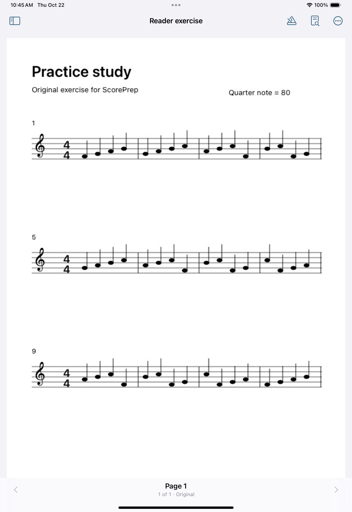
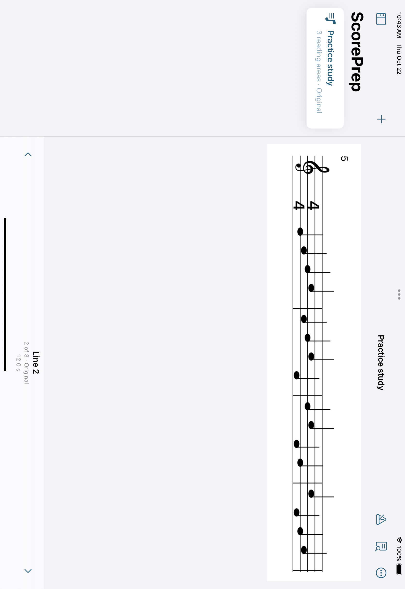
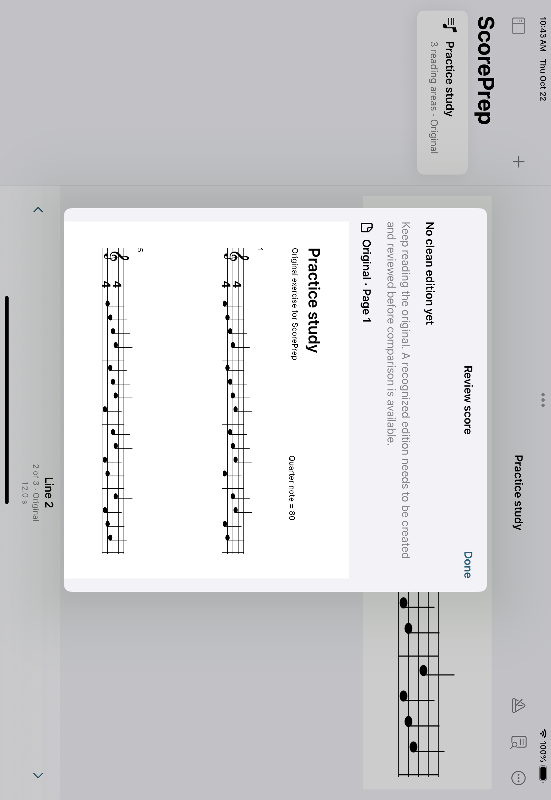
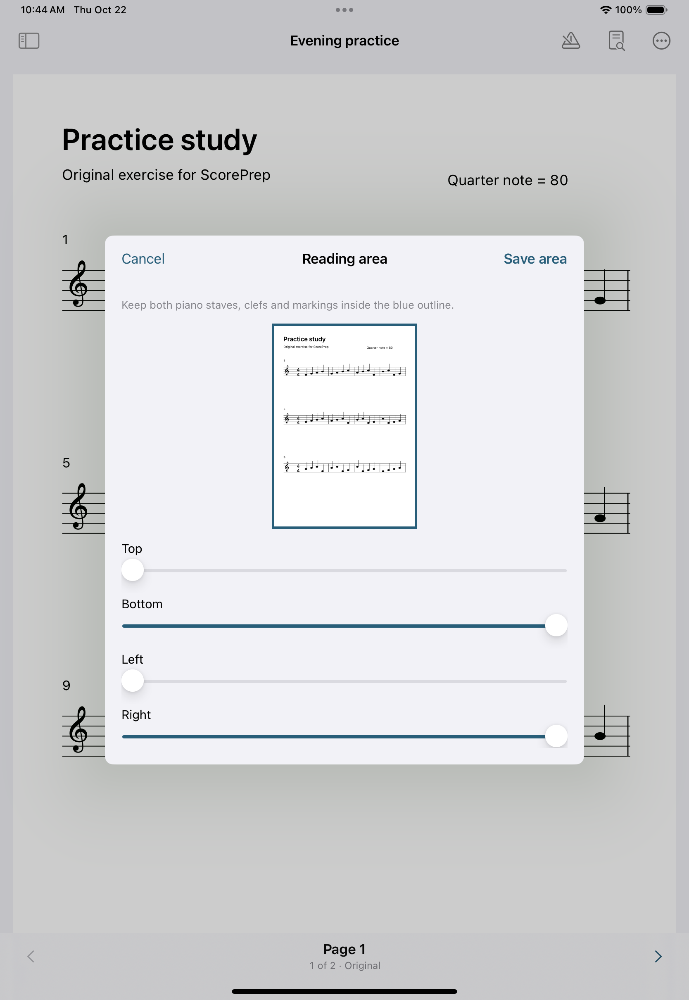

# Reader native verification

Verified on 22 October 2026. Original-reader slice; actual recognition and
Verovio composition are integration work.

## Passing native checks

[Run 39763128968](https://github.com/wenshanvincent-creator/scoreprep-ipad/actions/runs/39763128968)
checked final code commit 17a471b04efa80341e0d4033b85bfde75f0108a8:

- Xcode 16.4 (16F6), iPad Pro 11-inch (M4), iPadOS 18.5 simulator.
- 12 ScoreCore tests and 5 native UI tests passed, with zero failures.
- Generated two-page PDF, JPEG and PNG passed the actual copy/import path;
  imported bytes were compared against the original input before removing that
  external input. The saved scores then reopened across app cold launches.
- Rename, saved crop values, deletion, malformed-image errors, previous/next
  boundaries, horizontal swipe, rotated PDF and large text were exercised.
- The original sample timing editor still opens and retains its 12-second value.

The first run exposed selection restoration using SceneStorage: cold launching
returned to the sample. AppStorage now persists the last-opened project. Tests
kept their original reopen/crop/delete assertions and passed after the fix.

## Inspected native captures

Portrait image reopening shows the original raster image, with all three musical
lines and page navigation. Its source resolution is the generated fixture's
595 by 842 pixels; it is not a recognized or re-engraved score.

Landscape shows the native sidebar, complete source line and both navigation
controls. Full-screen capture after waiting for landscape geometry avoids the
partial frame produced by app-only capture during orientation changes.

Review identifies the original and puts the missing-clean-edition state before
the page. Integration replaces this destination through the injected callback.

## Final crop layout check

The final native run passed all 12 core and 5 UI tests. The crop test confirms
that the Top slider is hittable while the original preview is visible, changes
the top edge, saves, cold-reopens and checks the restored edge value. The full
preview and blue outline are visible above the independently scrolling controls;
Cancel and Save remain in the native toolbar. Remaining controls and the reset
action can scroll while the preview stays visible.

The inspected crop sheet is retained below; the raw artifact also includes
the reopened crop, image formats, large text and rotated PDF captures.

Final artifact ID: 12420051208. ZIP digest:
`sha256:1edff6bdd8aa5c9006b95e6417dd5c8b21c1fdf8103670a20624dbd927f42dab`.
These assets are unchanged native captures from the final run. This handoff adds
only documentation/screenshots after the tested code commit; no further code
changes or broader test runs were needed.

## Evidence boundary

UI fixtures enter ScoreLibrary directly; external Files-provider selection and
security-scoped cloud-provider delivery were not exercised by these tests.
Photos-library picking is not implemented. Actual iPad hardware, VoiceOver
spoken navigation, a narrow multitasking window, real camera EXIF variety and
performance on a representative score collection remain untested here.

No OMR model ran on this development PC. This slice does not establish a deployed
recognition worker, real score recognition, Verovio integration or V1 completion.
