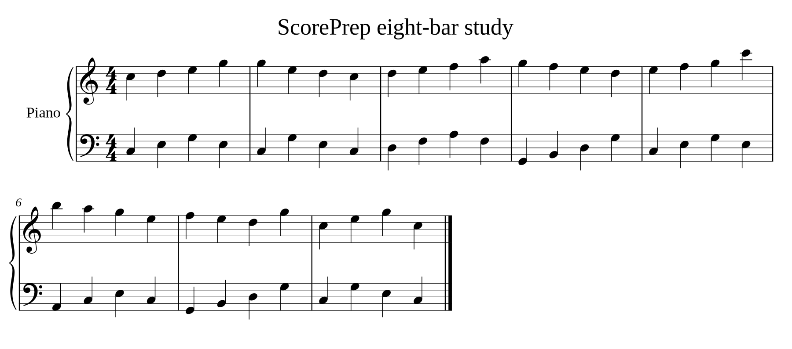
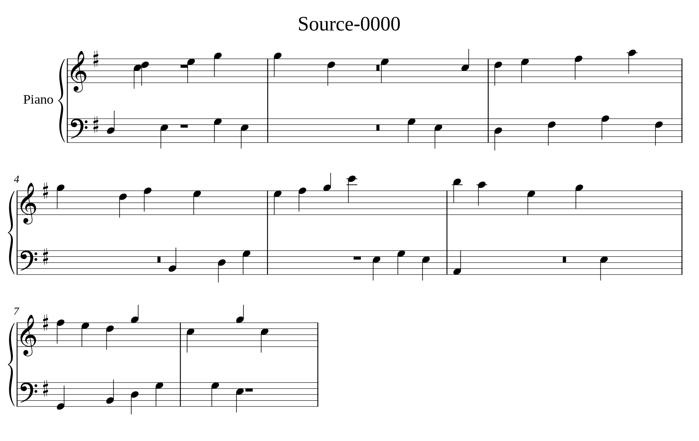

# Recognition and notation build evidence

Updated 22 October 2026. V1 recognition/rendering workstream; full app import,
comparison, persistence and reopen are integration-owned.

## Actual recognition

[Workflow 39759659441](https://github.com/wenshanvincent-creator/scoreprep-ipad/actions/runs/39759659441)
at branch commit 6b3a2c04185a99cc80e92145f3c68eed34ec40db completed an actual
printed PNG → authenticated worker API → oemer ONNX CLI → per-page MusicXML
trial on GitHub-hosted Ubuntu CPU. Worker job
16ea4bd6-f4eb-4806-8584-f6e4ec5b908c took approximately 351 seconds, excluding
installation. The worker API ran in process for this bounded trial; the actual
engine was a subprocess with real model inference. No public endpoint was
deployed. No model was run on the development PC.

Original exercise and untouched job/XML/model receipts are in
backend/fixtures/observed-omr. The upstream source and ONNX hashes are pinned;
dependency notices and unresolved model-data permission questions are in
backend/notices/PROVENANCE.md.

| Review item | Original | Observed recognition |
| --- | --- | --- |
| Measures | 8 | 8 |
| Note elements | 64 pitched quarter notes | 55 pitched notes and 9 rests |
| Key | C major, no sharps | One-sharp key; F naturals become F sharps |
| Time signature | 4/4 | Missing |
| First bass note | C3 | D3 |
| Other differences | Both hands have four quarters per bar | Missing notes, inserted rests and changed onset placement; final double barline missing |

The successful job state means that MusicXML was produced, not that its musical
content has been accepted. Every output page requires review. These errors are
retained without correction. The exercise is original MIT-licensed content;
this is one printed input, with no accuracy claim for photographs or arbitrary
multi-page scores. PDF page-order rasterization has a separate boundary test.

## Native engraving and interactions

Native verification is in progress on the independent workflow. It builds the
native Verovio Swift package at revision 425dd7b6ba26edcecbe345c10b15586d095743d9
(version-6.3.0) with Xcode 16.4, iPadOS 18 deployment target. The harness consumes
the actual job's MusicXML, separate from explicitly labeled fixture-only renders.
Portrait/landscape screenshots and manual-page/size checks must be inspected
before this section can be marked complete. A constrained 480-point component
and accessibility text configuration exercise narrow layouts; this does not
establish system Stage Manager behavior.

## Checks and remaining integration

Five worker boundary tests passed locally without any model invocation:
authorization/input failure, byte-identical original retention, actual PDF
rasterization order/dimensions, ordered partial-failure results and interrupted
job state. Stubbed subprocess checks are contract evidence only.

Minimal integration steps:

1. Configure an authenticated private HTTPS worker and a Keychain credential.
2. Submit original bytes through RecognitionClient, save the returned job ID,
   and display real completed-page progress or the preserved failure.
3. Save each MusicXML separately with sourcePageIndex; map it to the shared
   RecognizedEdition/RecognizedSourcePage persistence model as unreviewed.
4. Present RecognizedScoreView(pages:initialSourcePageIndex:onSourcePageChanged:)
   and keep original comparison and accept/reject controls aligned with its
   visible source index. Reconstruct successful page values from saved XML
   for offline reopen.
5. Verify the full import → recognize → original comparison → review → reopen
   flow in integration. Physical iPad validation and signed distribution have
   not been performed by this workstream.

The Docker recipe and private service settings are supplied in backend/README.md;
a container recipe is not evidence of a deployed endpoint. Model/data permission
resolution is needed before commercial release. No voice, following, metronome,
training or alternative-engine comparison is included.
