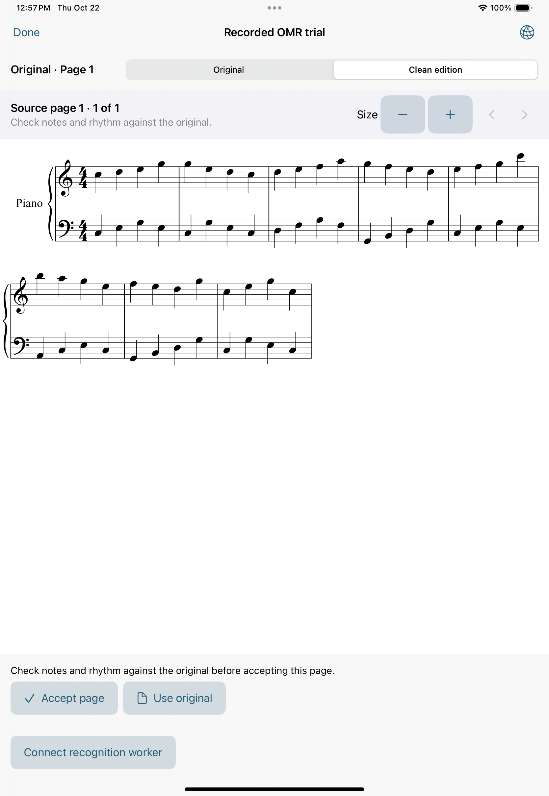
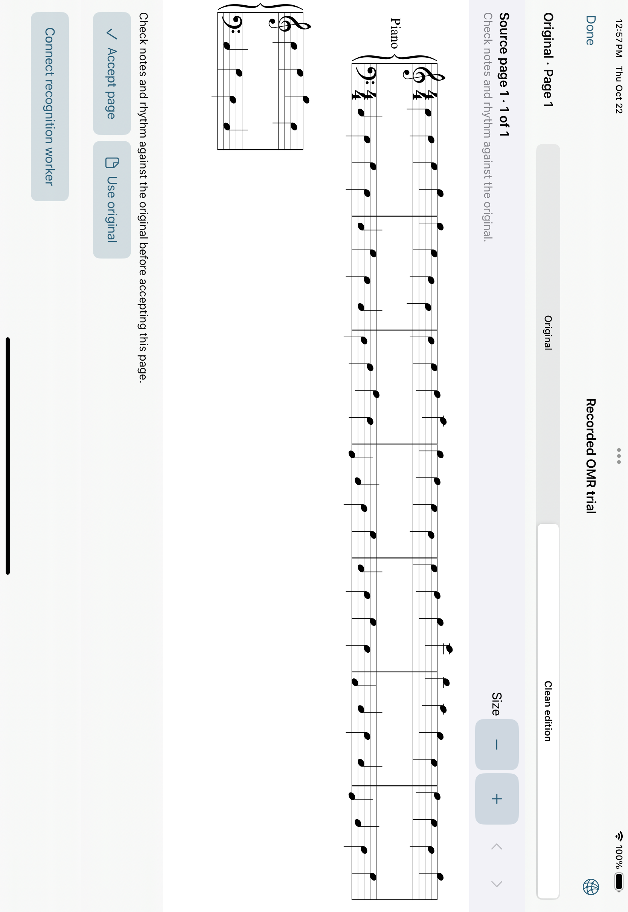
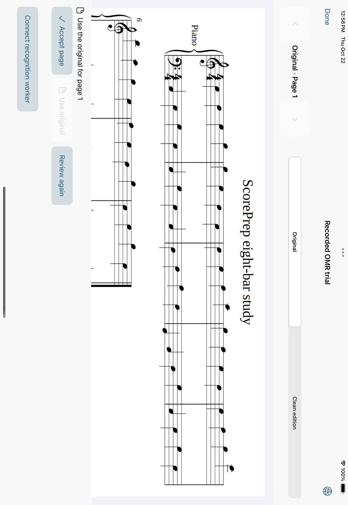

# V1 native verification checkpoint

22 October 2026. **V1 engineering gate passed at 276418b.**
The full v0.1 practice goal remains active.

## Accepted checkpoint

[App run 39780518636](https://github.com/wenshanvincent-creator/scoreprep-ipad/actions/runs/39780518636)
passed 13 Core, three native persistence and seven UI checks. This covers
PDF/JPEG/PNG import, original copy/reopen, crop/rename/delete, source rotation,
review/accept/reject/offline reopen, and actual Keychain validation/save/remove.
[Recognition run 39780518401](https://github.com/wenshanvincent-creator/scoreprep-ipad/actions/runs/39780518401)
passed actual cloud homr recognition, five native client/engraving unit checks
and three native UI checks. Toolkit hardening remains enabled.

The final integrated portrait and landscape captures show the recognized
grand staff with no alert or blank first frame. Rejection and cold reopen show
the unchanged original and saved rejection state; the full source is vertically
scrollable in landscape review. These four captures were independently
inspected. Artifact 12427163951 retains the full app evidence; its generated
simulator entitlement contains org.scoreprep.ScorePrep, and its signature is
ad-hoc. Xcode 16.4 (16F6), iPad Pro 11-inch (M4), iOS 18.5.

## Demonstration boundary

The cloud trial runs the pinned real engine through the authenticated worker
API in GitHub's Linux job. The native app walkthrough imports that actual
recorded result and tests local review/reopen; it makes no server request.
This establishes the engineering components on the owned exercise. A new
native conversion needs a separately provisioned private HTTPS worker, as
documented in backend/README.md; no production endpoint was deployed here.
The raw result matches 64 note pitch/onset/duration events, key and meter on
this exercise; its final barline style differs. Recognition remains unreviewed
until the musician accepts it. No broad photograph accuracy, physical iPad,
App Store signing or TestFlight result is claimed.

V2 still needs its multi-area/timing UI, shared-clock audio and current/upcoming
practice composition, controls and inspected demonstration. V1 does not
complete that engineering goal. The earlier failed checkpoints below preserve
the evidence for the three importer guards and simulator signing correction.

## Earlier runtime checkpoint

At b1c0e0b, app run
[39777128239](https://github.com/wenshanvincent-creator/scoreprep-ipad/actions/runs/39777128239)
passed 13 Core, three native persistence and seven native UI checks, including
the real Keychain save/reopen/remove flow. Recognition run
[39777128245](https://github.com/wenshanvincent-creator/scoreprep-ipad/actions/runs/39777128245)
passed actual homr recognition, five native unit and three native UI checks.
The actual-score portrait/landscape, largest-size page one/page two, and narrow
large-text harness captures were independently inspected and show complete
staves and working page navigation. Artifact 12425553520 retains those images.

The full-app landscape capture in artifact 12426461142 shows clear notation and
no entitlement alert. Its first portrait capture is blank: the accessibility
web view existed before SVG paint. The test capture now uses the same two-second
paint settle as the successful harness. That final integrated capture still
needs fresh verification before V1 acceptance. This is a capture timing change,
not a new engraver or a replacement recognition result.

Xcode's build log shows the simulator application-identifier in the generated
ScorePrep.app-Simulated.xcent. The earlier codesign entitlement dump is empty
because simulator entitlements use that separate generated representation;
it is not the Keychain entitlement receipt. CI now saves the generated xcent
and ad-hoc signature separately. Runtime Keychain behavior passed independently.

## Earlier failed checks

At integration 0b417bf, recognition workflow
[39773048865](https://github.com/wenshanvincent-creator/scoreprep-ipad/actions/runs/39773048865)
completed real homr recognition successfully. The native harness's four client
and engraving unit checks passed, including the actual homr piano-voice
regression. The three importer bounds guards therefore have native runtime
evidence on this fixture, rather than only source review.

The harness UI run failed while expecting a second notation page after size
changes. Its source-callback and narrow/large-text fixture checks passed. The
recognition workstream is inspecting actual pagination and captures before
changing that scenario. Artifact 12423913685 retains the failed run.

The separate practice foundation ef4525b includes that same integration source.
Its [run 39773187270](https://github.com/wenshanvincent-creator/scoreprep-ipad/actions/runs/39773187270)
passed 22 pure Core checks, including nine shared-clock transport checks, and
three app-hosted persistence checks. Its reader, recorded-result review and
smoke UI checks passed, but the worker-settings check failed. This does not
verify the later multi-area preparation save or native practice audio/UI.

## Simulator Keychain failure

Independent inspection of artifact 12424201731 found a visible alert reading
“A required entitlement isn't present.” It obscures the first recorded-result
portrait/landscape captures. The settings failure's accessibility snapshot
contains the expected HTTPS address; the save error is the same entitlement
failure. The prior build disabled code signing. The screenshots are failed
acceptance evidence even though the recorded-result test itself passed.

The next build enables ad-hoc simulator signing and supplies an
application-identifier entitlement for the ScorePrep simulator target only.
Keychain's default access group derives from the app's signed entitlements;
credentials continue to use the real Keychain API. There is no credential-file
fallback. See [Apple's entitlement error reference](https://developer.apple.com/documentation/security/errsecmissingentitlement).

The native UI checks now reject alerts over evidence captures and verify the
corrected address before saving. CI exports XCTest failure attachments as well
as direct captures and retains the simulator entitlement receipt. This is
simulator signing without a developer certificate or account; physical-device
and App Store signing remain separate. A new native result and inspected clean
captures must establish the fix before the V1 merge.
